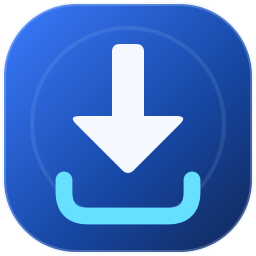
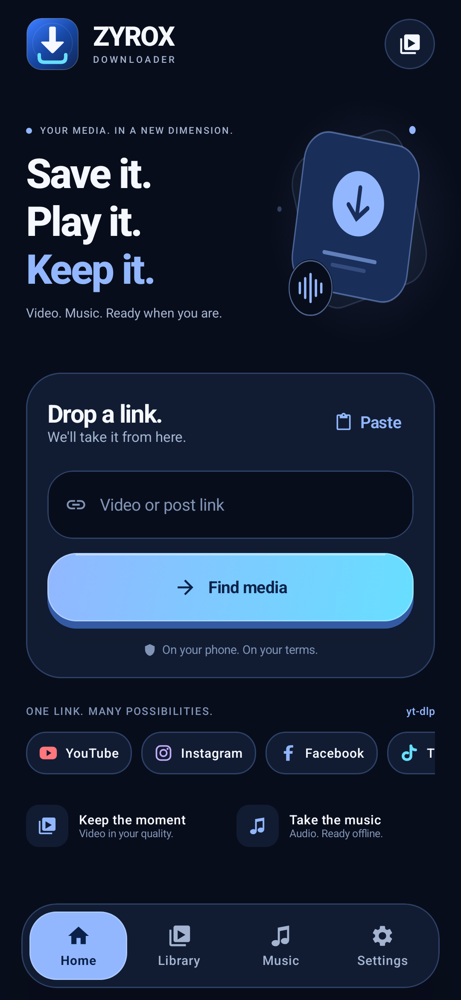
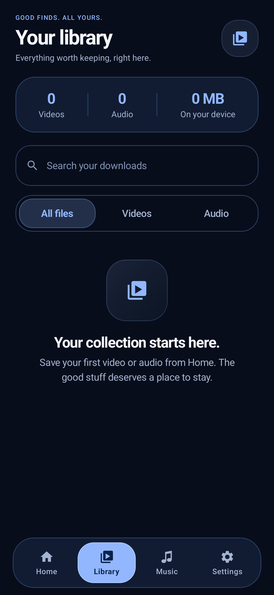
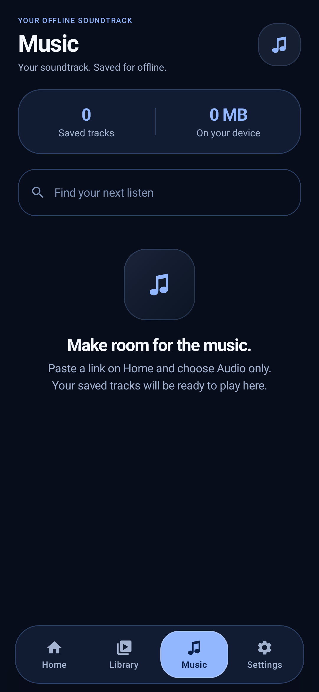
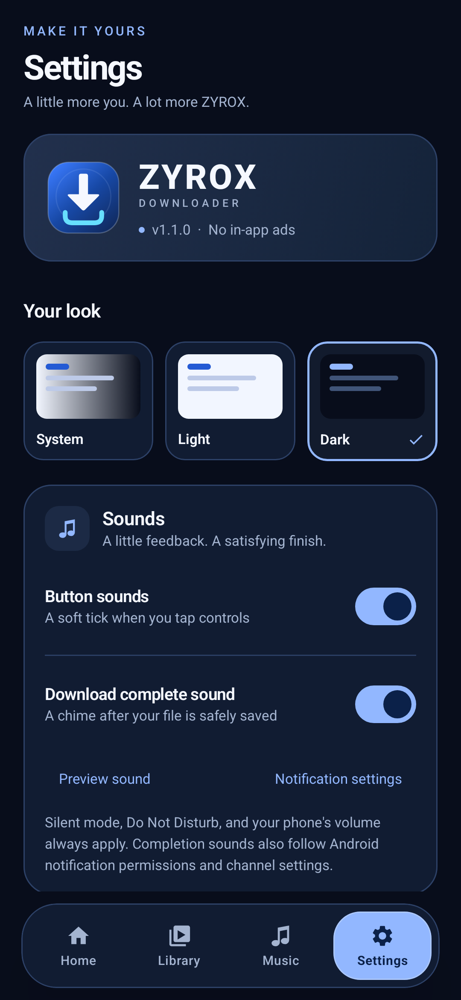
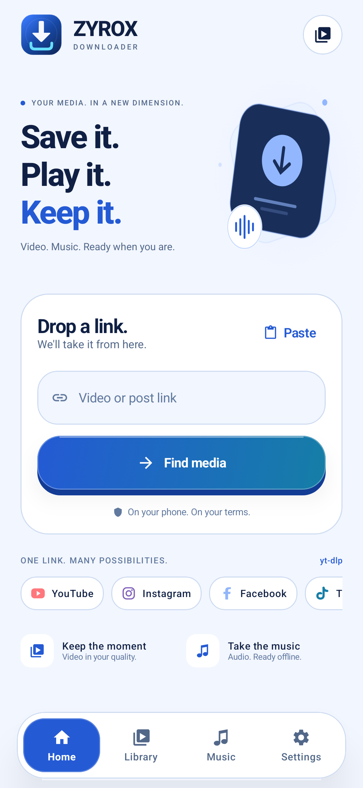
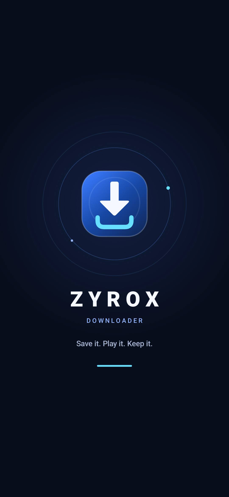

<div align="center">
  
  <h1>ZYROX DOWNLOADER</h1>
  <p><strong>Save it. Play it. Keep it.</strong></p>
  <p>An Android home for the videos and music you want to keep.<br />On-device downloads. An organized library. Curved controls and a fresh crystal-blue look.</p>
  <p>
    
    
    
    
  </p>
  <p>
    <a href="https://github.com/KMJ-TIPS/ZYROX-DOWNLOADER/releases/latest/download/ZYROX-DOWNLOADER-v1.1.0-arm64.apk"></a>
    <a href="https://github.com/KMJ-TIPS/ZYROX-DOWNLOADER/tree/main"></a>
  </p>
  <p><a href="https://kmj-tips.github.io/ZYROX-DOWNLOADER/">Download page</a> · <a href="https://github.com/KMJ-TIPS/ZYROX-DOWNLOADER/releases/latest">Release notes & assets</a> · <a href="https://github.com/KMJ-TIPS/ZYROX-DOWNLOADER/releases/latest/download/ZYROX-DOWNLOADER-source.zip">Source ZIP</a> · <a href="https://github.com/KMJ-TIPS/ZYROX-DOWNLOADER/releases/latest/download/SHA256SUMS.txt">Checksums</a></p>
</div>

## A closer look

**App UI renders, not device captures.** The gallery shows the app's appearance; it does not establish device playback or download compatibility.

| Home · Dark | Your library | Music |
| :---: | :---: | :---: |
|  |  |  |
| **Settings** | **Home · Light** | **Splash** |
|  |  |  |

## Built for the moments you keep

| Feature | What you can do |
| --- | --- |
| **Paste or share a link** | Paste a public video URL, or choose **Share → ZYROX DOWNLOADER** in another app. Fetch available formats before downloading. |
| **Choose your download** | Select an available video quality or audio format. yt-dlp and FFmpeg handle extraction and media processing on the phone. |
| **Follow every transfer** | See queue status, progress, transferred size, speed and ETA. Cancel or retry downloads from the library. |
| **Keep a useful library** | Search saved history, filter video and audio, and share or remove saved items. Audio has its own Music view. |
| **Play offline** | Use the native local video/audio player with seeking, replay and audio-focus handling. Playback pauses when you leave the player. |
| **Make it yours** | Switch between dark, light and system appearance. Enjoy the new download-arrow logo, cobalt/ice-cyan colours, curved raised buttons, physical press feedback and matching animated splash. |
| **Hear the finish** | Optional soft button ticks and an original download-complete chime. Control each sound in Settings and preview the finish tone. Phone volume, silent mode, DND and notification controls apply. |
| **Keep the engine current** | Check for official yt-dlp updates, with published checksum verification before installation. Engine updates do not replace the ZYROX app. |

YouTube, Instagram, Facebook, TikTok, X, Reddit, Vimeo and other sites are handled through yt-dlp. Support depends on the source site and the specific media; a platform appearing here is not a guarantee that every link works.

## Install

The provided APK is **62.3 MB** and supports **Android 10+ on ARM64 phones**.

1. [Download the APK](https://github.com/KMJ-TIPS/ZYROX-DOWNLOADER/releases/latest/download/ZYROX-DOWNLOADER-v1.1.0-arm64.apk).
2. Open it on your phone. If Android asks, allow your browser or file manager to install this APK.
3. Launch **ZYROX DOWNLOADER**, paste a public video link and fetch its available formats.

Notification permission is optional. Saved media is placed in `Movies/ZYROX/Video` and `Music/ZYROX/Audio` through Android's MediaStore.

| Build detail | Value |
| --- | --- |
| Version | `1.1.0` / code `2` |
| Application ID | `com.zyrox.downloader` |
| Minimum Android | Android 10 / API 29 |
| Target SDK | Android 16 / API 36 |
| Downloaded APK architecture | `arm64-v8a` |
| Signing | Release build, development certificate |

The downloadable build uses the same development signing identity as v1.0.0 and can update that installation. Configure your own private release key for production distribution; local keys are excluded from the source.

## What to expect

ZYROX runs its yt-dlp, Python and FFmpeg engine **on the device**. There is no developer-operated download server, ZYROX account or API key to configure. Downloads contact the source platforms; engine update checks contact GitHub. History and saved thumbnails remain on the device.

The app UI and local media playback have no in-app advertising. Button sounds follow Android Touch sounds and the system/ringer volume. Automatic completion audio uses Android notification channels after a file and its history record are safely saved; denied notifications, muted channels or Do Not Disturb can silence it. This app does not alter advertisements in the official YouTube player.

Private, login-only, geo-restricted or DRM media may be unavailable. This build does not import account cookies or promise access to every social account. Download media you own or have permission to save.

## Build from source

The Android app uses **Kotlin / Jetpack Compose**, with **Java** for the custom splash and local media player. It is a rebrand of the existing Android implementation, not a complete Java rewrite.

Install **JDK 17**, **Android SDK Platform 36** and **Build-Tools 36.0.0**. Open `Android/` in Android Studio or set `sdk.dir` in an untracked `Android/local.properties`. Follow the [build and signing notes](Android/docs/BUILD-NOTES-ZYROX.md) to generate the required local development keystore, then run:

```sh
cd Android
./gradlew testDebugUnitTest lintDebug assembleRelease
```

On Windows, use `gradlew.bat`. The wrapper downloads Gradle and dependencies on its first run. The APK is written to `Android/app/build/outputs/apk/release/app-release.apk`.

ARM64 is the default. You can build another supported architecture with `-PtargetAbis=armeabi-v7a` or `-PtargetAbis=x86_64`.

## Validation

The shipped build passed **73 JVM tests** with no failures, and Android lint completed with **0 errors and 10 warnings**. Release compilation, APK signature and ZIP alignment checks passed. The bundled engine also completed a public sample download on the build host.

Six production UI render cases passed with the opt-in [Paparazzi rendering setup](Android/docs/SCREENSHOT-RENDERS.md). The download site was checked at 320, 360, 768 and 1440 px with working links, gallery and FAQ.

**Phone and emulator runtime validation has not been performed.** The host download and UI renders do not verify Android player behavior or every platform's downloads. See the [validation record](Android/docs/VALIDATION-1.1.md) for the scope and remaining checks.

## Credits and licenses

Based on [Saurabh-gzp/VidGrab](https://github.com/Saurabh-gzp/VidGrab), upstream commit [`ffbb72a7044b37a3008bf61de8261411cacee951`](https://github.com/Saurabh-gzp/VidGrab/commit/ffbb72a7044b37a3008bf61de8261411cacee951). Original attribution is retained in the source and **Settings → About**.

The app includes yt-dlp, youtubedl-android, FFmpeg, CPython, QuickJS, AndroidX and other components with their own license terms. See [third-party notices and source references](Android/docs/THIRD_PARTY_NOTICES.md) before redistributing. The upstream README describes its application as MIT; the checkout did not include a standalone app license file.

Found a problem? [Open an issue](https://github.com/KMJ-TIPS/ZYROX-DOWNLOADER/issues) with your phone model, Android version, source platform and the error message.
