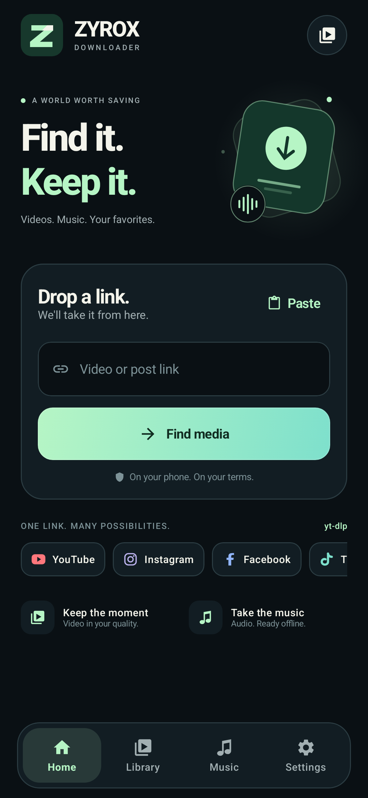
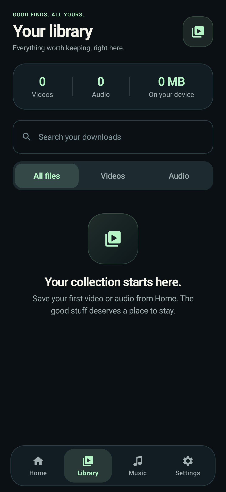
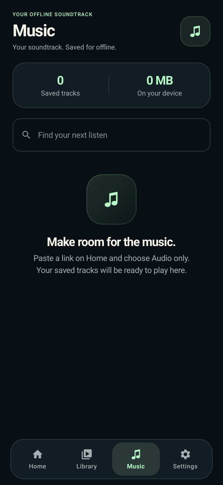
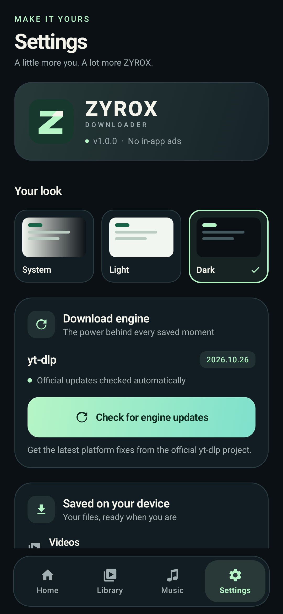
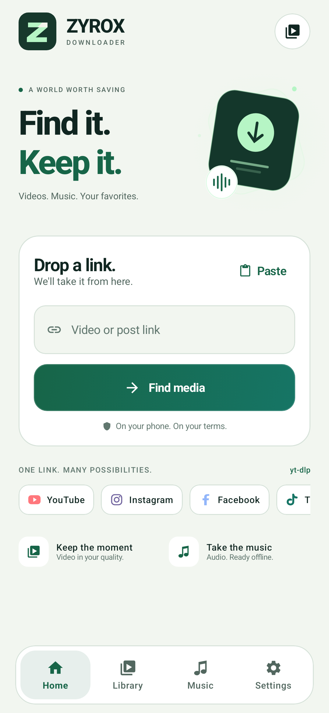
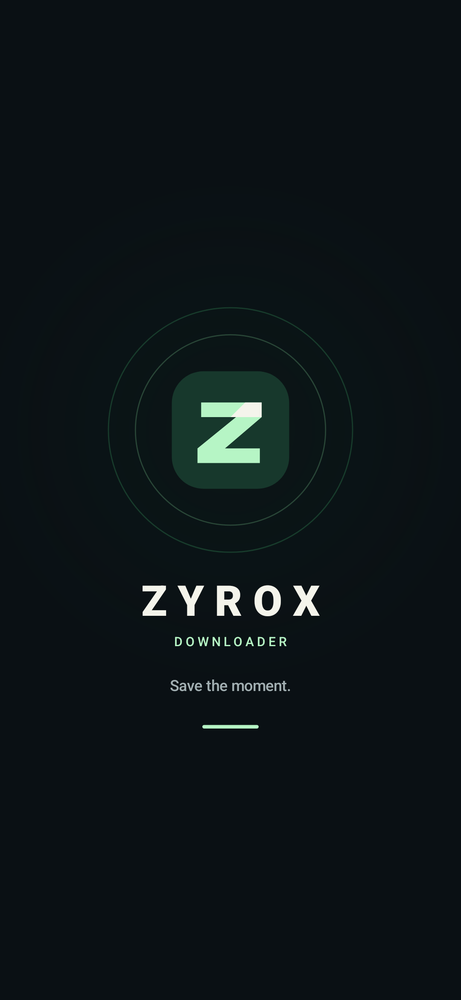

## ZYROX DOWNLOADER 1.0.0

**Save the moment.** A fresh ink-and-mint Android downloader, built on VidGrab with on-device yt-dlp and FFmpeg.

[](https://github.com/KMJ-TIPS/ZYROX-DOWNLOADER/releases/download/v1.0.0/ZYROX-DOWNLOADER-v1.0.0-arm64.apk)

### In this release

- New ZYROX logo, adaptive launcher icons and native Java animated splash.
- Redesigned Home, format selection, Library, Music and Settings with dark, light and system themes.
- Public-link downloads through yt-dlp, including available video quality and audio format choices.
- Download queue, live progress, cancel/retry, searchable history, sharing and media filters.
- Native local video/audio playback with seeking, replay and audio-focus handling. Playback pauses when leaving the player.
- Official yt-dlp engine updates with checksum verification.
- Separate app identity, `com.zyrox.downloader`, and public `Movies/ZYROX/Video` / `Music/ZYROX/Audio` folders.

### App preview

These are renders of the actual app UI, rather than phone captures.

| Home | Library | Music |
| :---: | :---: | :---: |
|  |  |  |
| **Settings** | **Light theme** | **Splash** |
|  |  |  |

[Open the download page](https://kmj-tips.github.io/ZYROX-DOWNLOADER/)

### Downloads

| Asset below | Purpose |
| --- | --- |
| `ZYROX-DOWNLOADER-v1.0.0-arm64.apk` | Install on Android 10+ ARM64 phones; 62.2 MB. |
| `ZYROX-DOWNLOADER-source.zip` | Editable Android project, brand assets and build documentation. |
| `SHA256SUMS.txt` | Verify downloaded release files. |

Download the APK and open it on your phone. Allow installation from your browser or file manager if Android requests it. The release build is signed with this fork's **development certificate**; source builders should configure their own private release key for production.

APK SHA-256:

```text
496f261a541aef1d3757c0ebb8bf57a08c2c090821cc80dfeb9b6893d8dd356c
```

### Validation and limits

**73 JVM tests passed.** Six production UI render cases passed and are shown above. Android lint: **0 errors, 23 warnings**. Release compilation, APK signature and ZIP alignment checks passed. The bundled engine completed a public sample download on the build host.

Phone/emulator runtime testing has not been performed. Images in the repository are app UI renders, not device captures. Platform downloads and native playback still need device verification.

Platform support follows yt-dlp and source-site access rules. Private, login-only, geo-restricted and DRM media may be unavailable; this build does not import account cookies. Save content you own or are allowed to download. The UI and local player have no in-app advertising; official YouTube player ads are not modified.

### Source and credits

The project remains **Kotlin / Jetpack Compose with Java splash and player components**. Build with JDK 17, Android SDK 36 and the included Gradle wrapper; follow the build/signing notes in the source.

Based on [Saurabh-gzp/VidGrab](https://github.com/Saurabh-gzp/VidGrab) commit [`ffbb72a7`](https://github.com/Saurabh-gzp/VidGrab/commit/ffbb72a7044b37a3008bf61de8261411cacee951). Original attribution and component notices are included. See [third-party notices](https://github.com/KMJ-TIPS/ZYROX-DOWNLOADER/blob/main/Android/docs/THIRD_PARTY_NOTICES.md).

[View source](https://github.com/KMJ-TIPS/ZYROX-DOWNLOADER) · [Report a problem](https://github.com/KMJ-TIPS/ZYROX-DOWNLOADER/issues)
