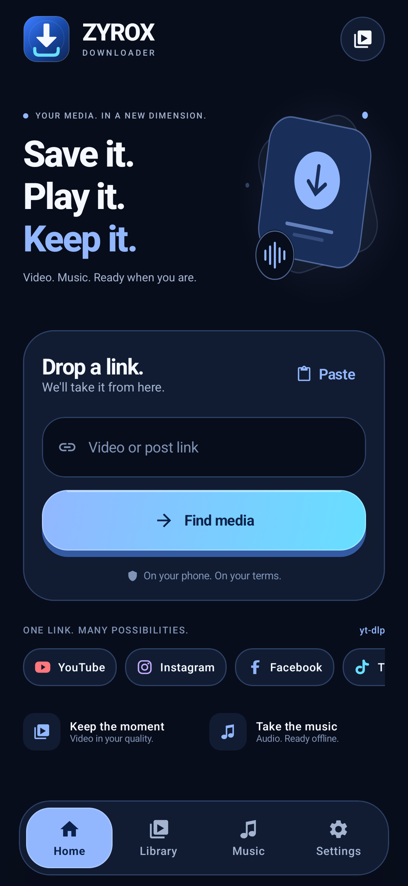
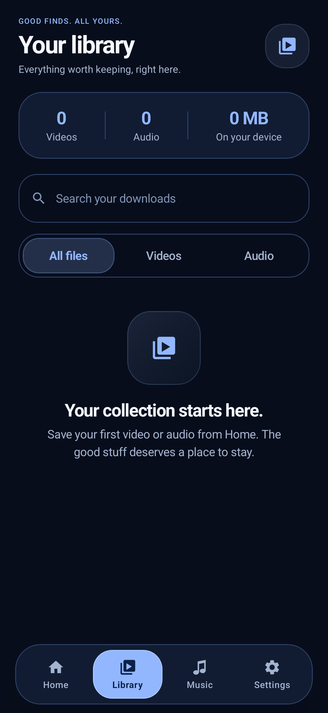
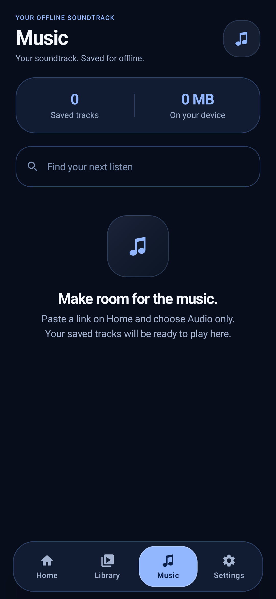
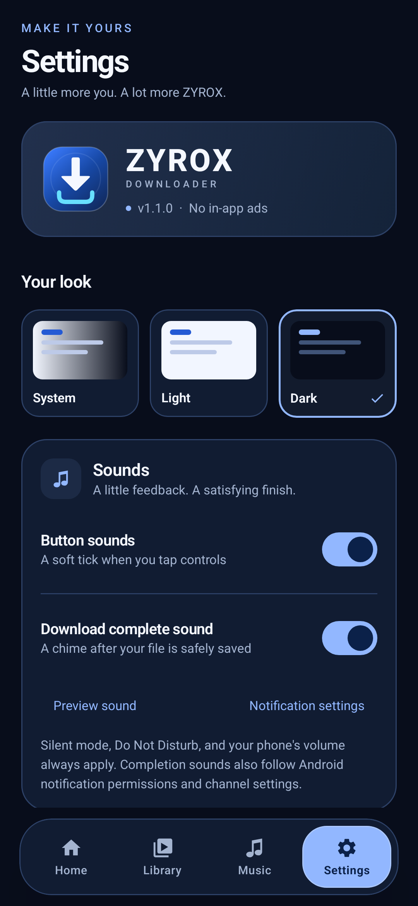
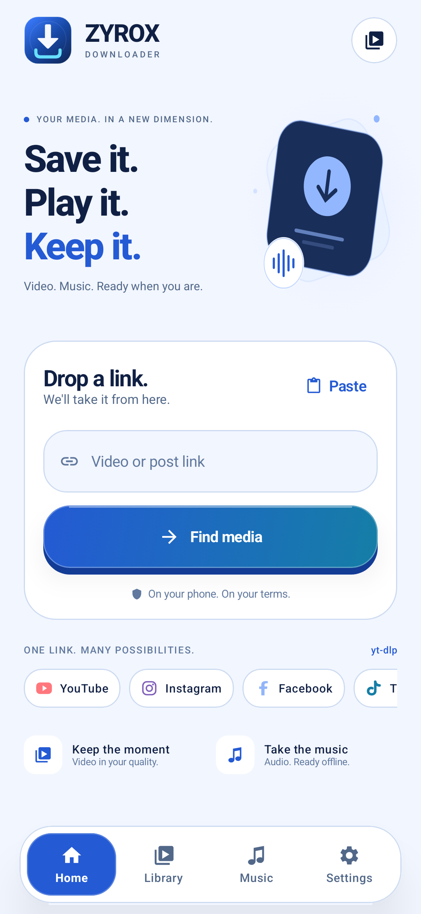
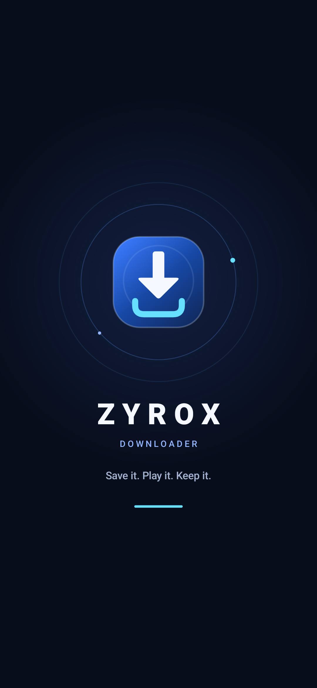

# ZYROX DOWNLOADER 1.1.0

**Save it. Play it. Keep it.** A new crystal-blue design with curved raised controls, an original download icon, and sounds you can control.

[](https://github.com/KMJ-TIPS/ZYROX-DOWNLOADER/releases/download/v1.1.0/ZYROX-DOWNLOADER-v1.1.0-arm64.apk)

[Download page](https://kmj-tips.github.io/ZYROX-DOWNLOADER/) · [Source code](https://github.com/KMJ-TIPS/ZYROX-DOWNLOADER/tree/v1.1.0/Android)

## What's new

- Cobalt blue and ice-cyan colours, with a matching white/deep-blue light theme.
- Curved raised buttons with a visible lower edge, glass highlight and physical press animation.
- Professional download-arrow logo and curved tray, adaptive launcher icons, and a matching animated native Java splash.
- Original soft button tick and a short completion chime after a file and its library record are safely saved.
- Separate persistent **Button sounds** and **Download complete sound** controls in Settings, plus an explicit sound preview and Android notification-settings shortcut.
- Refreshed download website inspired by the requested VidGrab page, with mobile navigation, raised download buttons, updated app previews, and optional website tap sounds.

Automatic completion chimes use Android notification channels. Phone volume, silent/vibrate, DND, notification permission and channel settings apply; failed/cancelled downloads stay quiet. The website's chime button is an explicit preview and does not claim to detect a browser download finishing.

Existing on-device yt-dlp/FFmpeg downloads, quality choices, video/audio extraction, queue/progress/cancel/retry, searchable history, sharing and local media playback remain available.

## App UI preview

Actual production UI renders from Android layoutlib, rather than phone captures.

| Home | Library | Music |
| :---: | :---: | :---: |
|  |  |  |
| **Settings & sounds** | **Light theme** | **Splash** |
|  |  |  |

## Install or update

**Android 10+ · ARM64 · version code 2.** The APK uses the same signing certificate as the delivered v1.0.0 build and can update it while retaining app history/preferences. It remains a release build signed with the documented development certificate.

Download the APK asset below and open it on your phone. Allow installation from the browser/file manager if Android asks. Enable notification permission if you want automatic completion notifications and their sound.

| Asset | Purpose |
| --- | --- |
| `ZYROX-DOWNLOADER-v1.1.0-arm64.apk` | Installable Android application. |
| `ZYROX-DOWNLOADER-source.zip` | Complete source, website, brand assets and sound/screenshot reproduction tools. |
| `SHA256SUMS.txt` | Check the release-file hashes. |

## Validation

**73 JVM tests and 6 production UI render cases passed.** Android lint: **0 errors, 10 warnings**. Release compilation, APK signature, ZIP alignment, exact v1.0 signing-certificate comparison, and both packaged sound-resource checks passed.

The bundled WAVs were checked for valid mono PCM, their durations and clipping; both are explicitly retained in the minified APK. The download site passed320/360/768/1440px browser checks, including its menu, gallery, opt-in tap sounds, explicit chime preview and reduced-motion settings. Physical-phone audio output, installation, notification behaviour and live platform downloads still need device verification.

APK SHA-256:

```text
6c3e197bfaae167b1ade97fd9ed6646a41a67fbee636072d295960f9a090dbee
```

Based on [Saurabh-gzp/VidGrab](https://github.com/Saurabh-gzp/VidGrab). Original project attribution and [third-party notices](https://github.com/KMJ-TIPS/ZYROX-DOWNLOADER/blob/v1.1.0/Android/docs/THIRD_PARTY_NOTICES.md) are retained. Platform access depends on yt-dlp and source-site rules.
